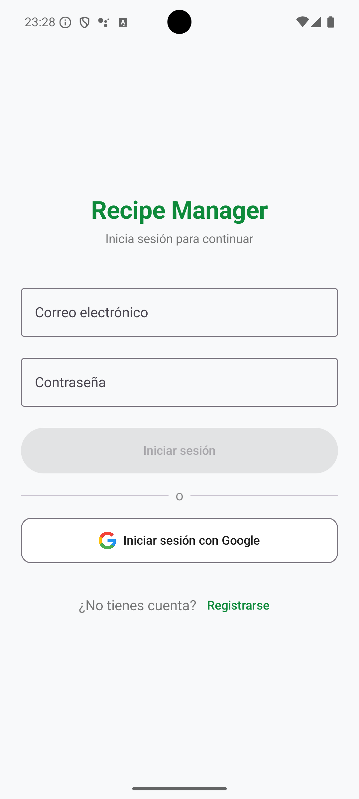
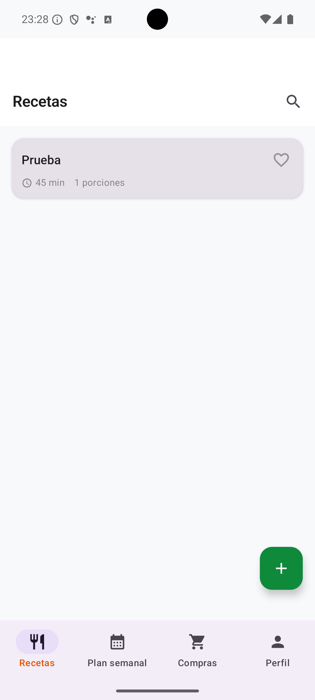
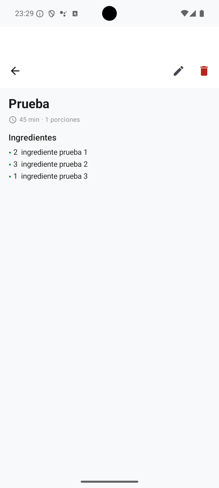
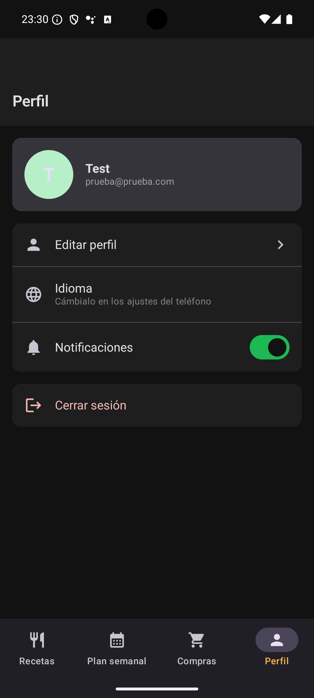
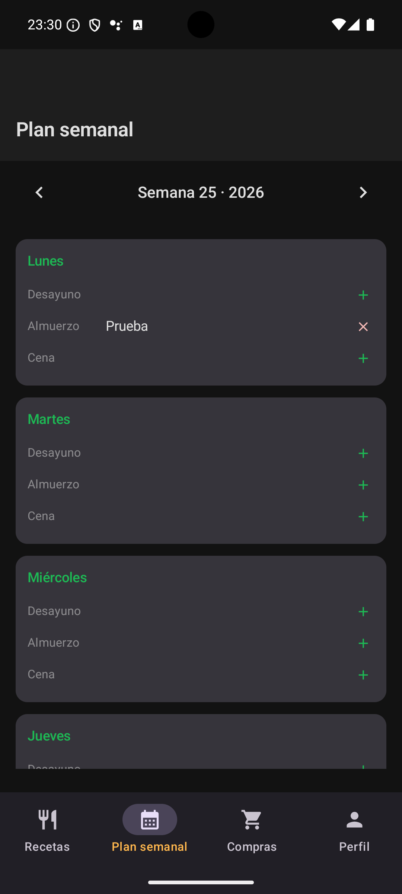
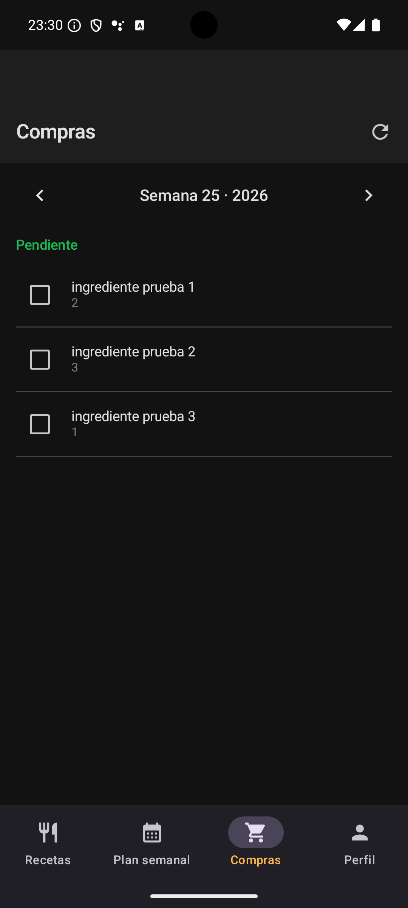

# Recipe Manager

An Android recipe and meal planning app built as part of the CastroDev portfolio. Create and manage your own recipes, plan your weekly meals, and generate automatic shopping lists — with TheMealDB integration to import thousands of external recipes.

---

## 📱 Screenshots

<p align="center">
  
  
  
  
</p>
<p align="center">
  
  
</p>

---

## ✨ Features

- 🍽️ **Recipes** — Create and manage recipes with ingredients, steps, prep/cook time and servings
- ✏️ **Edit recipes** — Update name, ingredients and steps at any time
- 🔍 **External search** — Search and import recipes from [TheMealDB](https://www.themealdb.com) (no API key required)
- ❤️ **Favourites** — Mark recipes as favourites for quick access
- 📅 **Weekly meal planner** — Assign breakfast, lunch and dinner to each day of the week
- 🛒 **Shopping list** — Auto-generated from the weekly meal plan; tap the refresh icon to regenerate after editing recipes
- ✅ **Check off items** — Mark ingredients as purchased while shopping
- 🌙 **Dark mode** — Automatic dark/light mode based on system settings
- 👤 **Profile** — Edit name, manage notifications; language follows system settings
- 🌍 **Multilingual** — English and Spanish support

> **Note:** The shopping list is generated from the current ingredients of each recipe in the meal plan. If you edit a recipe's ingredients, tap the refresh icon in the Shopping tab to regenerate the list with the updated data.

---

## 🛠️ Tech Stack

| Layer | Technology |
|---|---|
| Language | Kotlin |
| UI Framework | Jetpack Compose |
| State Management | ViewModel + StateFlow |
| Dependency Injection | Hilt |
| Authentication | Firebase Auth (Email + Google) |
| Backend | .NET 10 REST API (Clean Architecture) |
| Database | Cloud Firestore |
| External API | TheMealDB (free, no API key) |
| Networking | Retrofit + OkHttp |
| Image Loading | Coil |
| Logging | Timber |
| Testing | JUnit 4 + MockK + Turbine |
| Infrastructure | Google Cloud Run |

---

## 🏗️ Architecture

The app follows **Clean Architecture** per feature. The presentation layer depends on domain abstractions only; Hilt wires the data implementations.

```
recipemanager/
├── core/
│   ├── network/       # API config, token provider, interceptor
│   ├── util/          # safeCall (Result + logging)
│   └── theme/         # Colors, typography, Material3 theme
├── di/                # Hilt modules (network, Firebase, bindings)
├── features/
│   ├── auth/          # Login, register, Google Sign-In
│   ├── recipes/       # CRUD recipes, external search & import
│   ├── mealplan/      # Weekly meal planner
│   ├── shopping/      # Shopping list generation & management
│   └── profile/       # User profile & settings
└── navigation/        # App navigation & bottom tabs
```

Each feature follows the pattern:

```
Feature/
├── data/
│   ├── datasource/    # Retrofit API service & remote data source
│   ├── model/         # DTO models & request/response
│   └── repository/    # Repository implementations
├── domain/
│   ├── entity/        # Domain entities
│   ├── repository/    # Abstract repository interfaces
│   └── usecase/       # Business logic use cases
└── presentation/
    ├── screen/        # Composable screens
    ├── viewmodel/     # ViewModels with StateFlow
    └── components/    # Reusable UI components
```

---

## 🧭 Technical Decisions

- **Clean Architecture per feature.** Each feature has its own `data / domain / presentation`. The domain layer has no Android, Retrofit or Firebase code, so use cases and repository contracts can be tested on the JVM.
- **Hilt for dependency injection.** ViewModels receive their use cases through the constructor and never import the `data` package. Each repository interface is bound to its implementation in a single module (`BindingsModule`), so tests swap in fakes without touching production code.
- **ViewModel + StateFlow with sealed UI states.** Each screen exposes a `Loading / Success / Error` state, so the UI cannot show data that has not loaded.
- **`Result` with a `safeCall` helper instead of `runCatching`.** Repositories return `Result<T>` and log failures with Timber. `safeCall` re-throws `CancellationException`, which `runCatching` would swallow and turn into a failure when a coroutine is cancelled.
- **One Retrofit client, configured once.** A singleton OkHttp client adds the Firebase token through an interceptor. Request bodies are logged only in debug builds and the `Authorization` header is always redacted.
- **HTTP errors are not ignored.** Retrofit does not throw for `Response<Unit>` calls with an error status, so delete, update and toggle calls check the response and fail explicitly.
- **Use cases per operation.** Most only delegate to the repository; login and register also validate their input before calling it.
- **Shared .NET 10 API.** Business rules live on the server and the app only talks to it with the user's Firebase token. One backend serves every app in this portfolio.
- **Tests with fakes, MockK and Turbine.** Use cases, the recipes repository and the ViewModels are covered with in-memory fakes of the domain interfaces. MockK is used where the collaborator is a concrete class (the remote data source).

### Other projects in this portfolio

| Project | Platform | Language |
|---|---|---|
| [finance-tracker](https://github.com/gcalvarez93/finance-tracker) | Flutter (iOS + Android) | Dart |
| [habit-tracker](https://github.com/gcalvarez93/habit-tracker) | Flutter (iOS + Android) | Dart |
| [task-manager](https://github.com/gcalvarez93/task-manager) | iOS | Swift |
| [budget-scanner](https://github.com/gcalvarez93/budget-scanner) | iOS | Swift |
| [recipe-manager](https://github.com/gcalvarez93/recipe-manager) | Android | Kotlin |
| [workout-tracker](https://github.com/gcalvarez93/workout-tracker) | Android | Kotlin |
| [castrodev-api](https://github.com/gcalvarez93/castrodev-api) | Shared backend | C# (.NET 10) |

---

## 🚀 Getting Started

### Prerequisites

- Android Studio Hedgehog or later
- Android SDK 26+
- Firebase project configured
- API running at `api.castrodev.com` or locally

### Installation

```bash
# Clone the repository
git clone https://github.com/gcalvarez93/recipe-manager.git

# Open in Android Studio
```

Then:

1. Add your `google-services.json` to the `app/` folder
2. Sync Gradle dependencies
3. Build and run with the Run button or `Shift + F10`

### Running Tests

```bash
./gradlew test
```

---

## 🔗 Related

- [CastroDev API](https://github.com/gcalvarez93/castrodev-api) — Shared .NET 10 backend
- [Finance Tracker](https://github.com/gcalvarez93/finance-tracker) — Personal finance app (Flutter)
- [Habit Tracker](https://github.com/gcalvarez93/habit-tracker) — Daily habit tracking app (Flutter)
- [Task Manager](https://github.com/gcalvarez93/task-manager) — Board-based task management (iOS)
- [Budget Scanner](https://github.com/gcalvarez93/budget-scanner) — Budget & expense tracking (iOS)

---

## 📄 License

MIT © Gabriel Castro

---

---

# Recipe Manager

App Android de gestión de recetas y planificación de comidas desarrollada como parte del portfolio de CastroDev. Crea y gestiona tus propias recetas, planifica tus comidas semanales y genera listas de la compra automáticas — con integración con TheMealDB para importar miles de recetas externas.

---

## ✨ Funcionalidades

- 🍽️ **Recetas** — Crea y gestiona recetas con ingredientes, pasos, tiempo de preparación y porciones
- ✏️ **Editar recetas** — Actualiza nombre, ingredientes y pasos en cualquier momento
- 🔍 **Búsqueda externa** — Busca e importa recetas de [TheMealDB](https://www.themealdb.com) (sin API key)
- ❤️ **Favoritos** — Marca recetas como favoritas para acceso rápido
- 📅 **Plan semanal** — Asigna desayuno, almuerzo y cena a cada día de la semana
- 🛒 **Lista de la compra** — Generada automáticamente desde el plan semanal; pulsa el icono de actualizar para regenerarla tras editar recetas
- ✅ **Marcar ingredientes** — Marca los ingredientes como comprados mientras haces la compra
- 🌙 **Modo oscuro** — Modo oscuro/claro automático según la configuración del sistema
- 👤 **Perfil** — Edita tu nombre y gestiona notificaciones; el idioma sigue los ajustes del sistema
- 🌍 **Multiidioma** — Soporte para español e inglés

> **Nota:** La lista de la compra se genera a partir de los ingredientes actuales de cada receta del plan. Si editas los ingredientes de una receta, pulsa el icono de actualizar en la pestaña Compras para regenerar la lista con los datos actualizados.

---

## 🛠️ Stack Tecnológico

| Capa | Tecnología |
|---|---|
| Lenguaje | Kotlin |
| UI Framework | Jetpack Compose |
| Estado | ViewModel + StateFlow |
| Inyección de dependencias | Hilt |
| Autenticación | Firebase Auth (Email + Google) |
| Backend | API REST .NET 10 (Clean Architecture) |
| Base de datos | Cloud Firestore |
| API Externa | TheMealDB (gratuita, sin API key) |
| Red | Retrofit + OkHttp |
| Imágenes | Coil |
| Logging | Timber |
| Testing | JUnit 4 + MockK + Turbine |
| Infraestructura | Google Cloud Run |

---

## 🧭 Decisiones Técnicas

- **Clean Architecture por feature.** Cada feature tiene su propio `data / domain / presentation`. La capa de dominio no tiene código de Android, Retrofit ni Firebase, así que los casos de uso y los contratos de repositorio se prueban en la JVM.
- **Hilt para la inyección de dependencias.** Los ViewModels reciben sus casos de uso por constructor y nunca importan el paquete `data`. Cada interfaz de repositorio se enlaza con su implementación en un único módulo (`BindingsModule`), así que los tests sustituyen las dependencias por fakes sin tocar el código de producción.
- **ViewModel + StateFlow con estados de UI sellados.** Cada pantalla expone un estado `Loading / Success / Error`, y la UI no puede mostrar datos que no se han cargado.
- **`Result` con un helper `safeCall` en lugar de `runCatching`.** Los repositorios devuelven `Result<T>` y registran los fallos con Timber. `safeCall` vuelve a lanzar `CancellationException`, que `runCatching` se tragaría y convertiría en fallo cuando se cancela una corrutina.
- **Un único cliente Retrofit, configurado una vez.** Un cliente OkHttp singleton añade el token de Firebase mediante un interceptor. Los cuerpos de las peticiones solo se registran en builds de debug y la cabecera `Authorization` siempre se oculta.
- **Los errores HTTP no se ignoran.** Retrofit no lanza excepción en las llamadas `Response<Unit>` con un estado de error, así que borrar, actualizar y marcar favoritos comprueban la respuesta y fallan de forma explícita.
- **Casos de uso por operación.** La mayoría solo delegan en el repositorio; login y registro además validan los datos antes de llamarlo.
- **API compartida en .NET 10.** Las reglas de negocio viven en el servidor y la app solo habla con él usando el token de Firebase del usuario. Un solo backend sirve a todas las apps de este portfolio.
- **Tests con fakes, MockK y Turbine.** Casos de uso, el repositorio de recetas y los ViewModels están cubiertos con fakes en memoria de las interfaces del dominio. MockK se usa donde el colaborador es una clase concreta (el datasource remoto).

### Otros proyectos del portfolio

| Proyecto | Plataforma | Lenguaje |
|---|---|---|
| [finance-tracker](https://github.com/gcalvarez93/finance-tracker) | Flutter (iOS + Android) | Dart |
| [habit-tracker](https://github.com/gcalvarez93/habit-tracker) | Flutter (iOS + Android) | Dart |
| [task-manager](https://github.com/gcalvarez93/task-manager) | iOS | Swift |
| [budget-scanner](https://github.com/gcalvarez93/budget-scanner) | iOS | Swift |
| [recipe-manager](https://github.com/gcalvarez93/recipe-manager) | Android | Kotlin |
| [workout-tracker](https://github.com/gcalvarez93/workout-tracker) | Android | Kotlin |
| [castrodev-api](https://github.com/gcalvarez93/castrodev-api) | Backend compartido | C# (.NET 10) |

---

## 🚀 Instalación

### Requisitos previos

- Android Studio Hedgehog o posterior
- Android SDK 26+
- Proyecto Firebase configurado
- API disponible en `api.castrodev.com` o en local

### Pasos

```bash
# Clonar el repositorio
git clone https://github.com/gcalvarez93/recipe-manager.git

# Abrir en Android Studio
```

A continuación:

1. Añade tu `google-services.json` a la carpeta `app/`
2. Sincroniza las dependencias de Gradle
3. Compila y ejecuta con el botón Run o `Shift + F10`

### Tests

```bash
./gradlew test
```

---

## 🔗 Relacionado

- [CastroDev API](https://github.com/gcalvarez93/castrodev-api) — Backend compartido en .NET 10
- [Finance Tracker](https://github.com/gcalvarez93/finance-tracker) — App de finanzas personales (Flutter)
- [Habit Tracker](https://github.com/gcalvarez93/habit-tracker) — App de seguimiento de hábitos (Flutter)
- [Task Manager](https://github.com/gcalvarez93/task-manager) — Gestión de tareas por tableros (iOS)
- [Budget Scanner](https://github.com/gcalvarez93/budget-scanner) — Seguimiento de presupuestos (iOS)

---

## 📄 Licencia

MIT © Gabriel Castro
